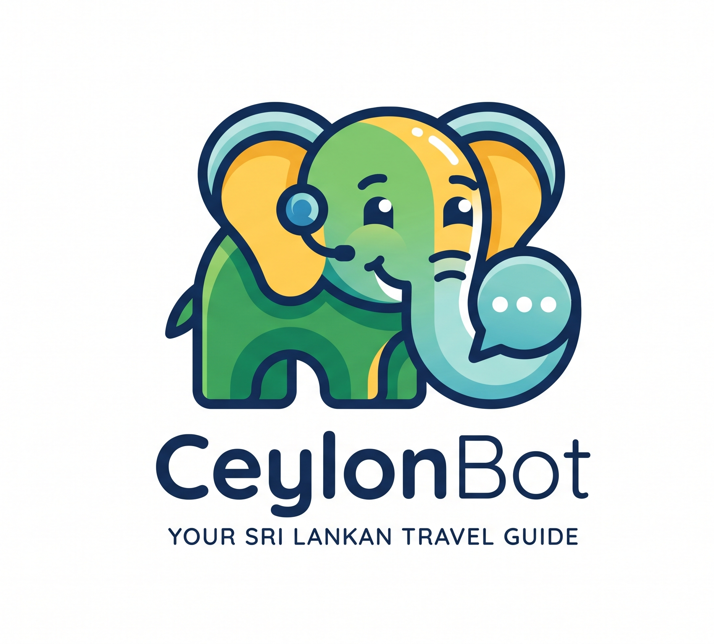

# 🌴 CeylonBot — Sri Lanka Tour Planning AI Assistant

<p align="center">
  
</p>

<p align="center">
  <strong>An intelligent, interactive AI assistant and tour recommendation engine designed for Sri Lanka travel planning.</strong>
</p>

<p align="center">
  
  
  
  
  
</p>

---

## 📖 Overview

**CeylonBot** is a full-featured web-based conversational assistant crafted specifically for tourists and travelers exploring Sri Lanka. It combines Natural Language Processing (NLP) with an active-learning feedback loop to answer travel questions, recommend tailored tour packages, provide local tips, and expand its own intelligence over time.

CeylonBot is accompanied by a **Glassmorphism Web Chat UI** featuring dynamic avatar emotion animations, alongside a comprehensive **Admin Dashboard** for live knowledge base and tour package curation.

---

## ✨ Key Features

- 🧠 **Hybrid Multi-Signal NLP Matcher**:
  - **TF-IDF Vectorization & Cosine Similarity** (weighted at 60%).
  - **Domain Keyword Overlap Analysis** (weighted at 40%).
  - **Dynamic Confidence Thresholds** calibrated to input length (0.30 - 0.38) to minimize false positives.
- 🔤 **Custom Preprocessing Pipeline**:
  - Lightweight Porter-style rule-based suffix stemmer (`-ing`, `-tion`, `-ies`, etc.).
  - Conversational stopword removal tailored for queries.
  - Domain-specific synonym expansion (e.g., `cheap` ⇄ `budget`, `rain` ⇄ `weather`, `hotel` ⇄ `accommodation`).
- 🎓 **Active Human-in-the-Loop Learning**:
  - When the bot encounters an unknown query, it prompts the user to teach it.
  - Automatically persists new question-answer pairs into the SQLite database and instantly retrains the TF-IDF model in real-time.
- 📦 **Tour Package Search & Recommendation**:
  - Filters curated itineraries across categories (Cultural, Historical, Nature, Wildlife, Beach, Adventure).
  - Rich HTML card renderings showcasing destinations, durations, and pricing.
- 🎭 **Emotional Avatar Feedback**:
  - Responsive visual reactions: **Thinking** (pulsing glow), **Happy** (blue glow on successful responses), and **Confused** (amber glow when requiring assistance).
- 🛠️ **Full-Featured Admin Panel**:
  - Manage and inspect Domain Knowledge, Tour Packages, and User-Learned Q&As.
  - Add or delete entries with one-click actions.
  - Real-time statistics counters and instant model retraining triggers.

---

## 🏛️ System Architecture

```mermaid
flowchart TD
    User([User in Browser]) -->|HTTP POST /chat| FlaskApp[Flask Web Server (app.py)]
    
    subgraph NLP Engine (inference.py)
        Preprocess[Preprocessing & Tokenization\n- Lowercase & Punctuation Strip\n- Custom Suffix Stemmer\n- Stopword Filter & Synonym Expansion]
        TFIDF[TF-IDF N-Gram Vectorizer\nCosine Similarity (60%)]
        KeywordScore[Domain Keyword Matcher\nKeyword Overlap (40%)]
        Scorer{Combined Confidence >= Threshold?}
    end

    subgraph Data & Storage (database.py)
        DB[(SQLite: chatbot.db)]
        PTable[packages table]
        DKTable[domain_knowledge table]
        LQATable[learned_qa table]
        DB --> PTable
        DB --> DKTable
        DB --> LQATable
    end

    FlaskApp --> Preprocess
    Preprocess --> TFIDF
    Preprocess --> KeywordScore
    TFIDF --> Scorer
    KeywordScore --> Scorer
    
    Scorer -->|Match Found| Reply[Format Response + Emotion: happy]
    Scorer -->|Tour Keyword| SearchPkg[Search Packages in DB]
    Scorer -->|No Match| LearnState[Ask User to Teach + Emotion: confused]
    
    SearchPkg --> Reply
    LearnState -->|User Teaches Answer| SaveLearned[Save to learned_qa in DB & Retrain Model]
    SaveLearned --> FlaskApp
    Reply --> FlaskApp
    FlaskApp --> User
```

---

## 📂 Project Directory Structure

```plaintext
Ceylon Bot/
├── app.py              # Main Flask server, routing, session management, and Admin REST APIs
├── database.py         # SQLite connection, schemas, and CRUD operations
├── inference.py        # NLP pipeline (stemming, synonyms, TF-IDF matching, active learning)
├── seed_data.py        # Comprehensive Sri Lanka knowledge base seeder (>300 entries)
├── chatbot.db          # SQLite database (auto-generated)
├── requirements.txt    # Python dependencies
└── static/
    ├── index.html      # Main user chat interface
    ├── admin.html      # Admin dashboard for knowledge and package management
    ├── style.css       # Glassmorphism styling, layout, and avatar animations
    ├── script.js       # Client-side chat logic, API calls, and emotion state handler
    └── Logo.png        # CeylonBot logo and avatar graphic
```

---

## ⚙️ Installation & Setup

### 1. Prerequisites
- **Python 3.8+** installed on your system.
- Git (optional, for cloning).

### 2. Clone or Navigate to Project
```bash
cd "Ceylon Bot"
```

### 3. (Optional) Set Up Virtual Environment
```bash
# Windows
python -m venv venv
venv\Scripts\activate

# macOS / Linux
python3 -m venv venv
source venv/bin/activate
```

### 4. Install Dependencies
```bash
pip install -r requirements.txt
```
*Required packages: `Flask`, `scikit-learn`, `numpy`.*

### 5. Seed the Knowledge Base
Populate the database with pre-configured Sri Lanka tourism knowledge and packages:
```bash
python seed_data.py
```
> **Note:** If `chatbot.db` does not exist, running `seed_data.py` or `app.py` will automatically initialize it with the default tables and tour packages.

---

## 🚀 Running the Application

Start the Flask server:
```bash
python app.py
```

By default, the server runs on `http://127.0.0.1:5000/`.

- 💬 **User Chat Interface**: [http://localhost:5000/](http://localhost:5000/)
- 🛠️ **Admin Management Panel**: [http://localhost:5000/admin](http://localhost:5000/admin)

---

## 💡 Example Queries to Try

| Category | Example Question |
| :--- | :--- |
| **Tour Packages** | *"What packages do you have?"* or *"Show me wildlife safari tours"* |
| **Visa & Entry** | *"Do I need a visa for Sri Lanka?"* or *"How to get an ETA?"* |
| **Weather & Seasons** | *"What is the best time to visit Sri Lanka?"* or *"Does it rain a lot?"* |
| **Cuisine & Food** | *"What food should I try?"* or *"What is Kottu Roti?"* |
| **Transport** | *"How to travel from Kandy to Ella?"* or *"Is Uber available?"* |
| **Culture & Etiquette**| *"What should I wear at temples?"* or *"What language do they speak?"* |
| **Attractions** | *"Tell me about Sigiriya"* or *"Where are Ramboda falls?"* |
| **Interactive Learning** | Ask any unknown question (e.g., *"What is your favorite tea?"*), then enter an answer when prompted to teach CeylonBot! |

---

## 📡 REST API Reference

The server exposes endpoints for both the chat engine and admin operations:

### Chat & Inference
| Method | Endpoint | Description |
| :--- | :--- | :--- |
| `POST` | `/chat` | Processes user messages, returns response text, emotion tag, and manages interactive learning state. |

### Tour Packages Management
| Method | Endpoint | Description |
| :--- | :--- | :--- |
| `GET` | `/api/packages` | Retrieve all tour packages with their IDs. |
| `POST` | `/api/packages` | Add a new tour package (`name`, `destination`, `description`, `price`, `duration`, `category`). |
| `DELETE`| `/api/packages/<id>` | Delete a tour package by ID and automatically retrain model. |

### Domain Knowledge Management
| Method | Endpoint | Description |
| :--- | :--- | :--- |
| `GET` | `/api/knowledge` | Retrieve all pre-configured domain knowledge entries. |
| `POST` | `/api/knowledge` | Add a domain Q&A entry (`question`, `answer`, `category`, `keywords`). |
| `DELETE`| `/api/knowledge/<id>` | Delete a domain entry by ID and retrain model. |

### Learned Q&A Management
| Method | Endpoint | Description |
| :--- | :--- | :--- |
| `GET` | `/api/learned` | Retrieve all user-taught Q&A pairs. |
| `DELETE`| `/api/learned/<id>` | Remove a user-taught Q&A entry and retrain model. |
| `POST` | `/api/retrain` | Force an immediate TF-IDF vectorizer re-fit across all data sources. |

---

## 🎨 Technology Stack

- **Backend**: Python, [Flask](https://flask.palletsprojects.com/)
- **Machine Learning & NLP**: [Scikit-Learn](https://scikit-learn.org/) (`TfidfVectorizer`, `cosine_similarity`), [NumPy](https://numpy.org/)
- **Database**: SQLite3
- **Frontend**: Vanilla JavaScript (ES6+), HTML5, CSS3 Glassmorphism
- **Typography**: [Google Fonts (Outfit)](https://fonts.google.com/specimen/Outfit)

---

## 🤝 Contributing & Customization

1. **Adding New Knowledge**: You can add entries either through the Web Admin (`/admin`), or by adding new tuples to `DOMAIN_DATA` in [seed_data.py](seed_data.py) and executing `python seed_data.py`.
2. **Expanding Synonyms & Stemming Rules**: Edit `SYNONYMS` or `STEM_RULES` in [inference.py](inference.py) to incorporate new terminology or slang.

---

## 📄 License

This project is open-source and available under the [MIT License](LICENSE).
